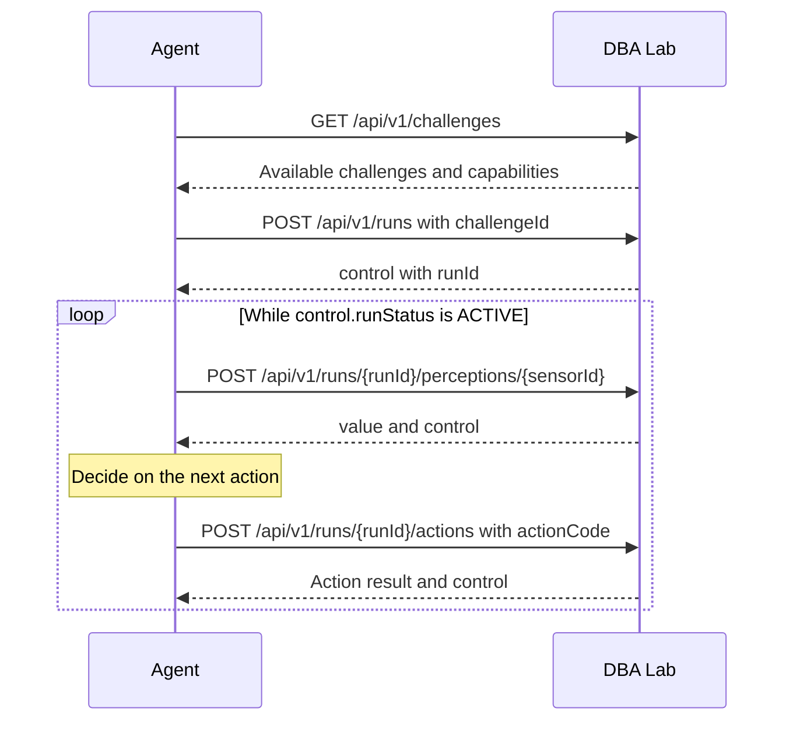

# Connecting to DBA Lab

This guide describes the interaction shared by the thermostat and Grid challenges. The perceptions and actions specific to each environment are described in their respective guides. Each group decides how to organise the code that sends requests and integrates the responses into its JADE agent.

Access to the DBA Lab server requires a connection from within the UGR network or through the UGR VPN.

## The lifecycle of a run



An available challenge announces its `id`, `environmentType`, `sensorCodes` and `actionCodes`. Obtain these codes from `challenges`; do not hard-code numeric identifiers in your program. Starting a challenge returns `control.runId`, which identifies that particular run. Reading a sensor does not advance the environment. An action response says whether the action was applied, but it does not replace a new sensor reading.

`control.runStatus` is `ACTIVE` while the run continues. `SUCCEEDED`, `FAILED`, `EXPIRED` and `INTERRUPTED` are terminal states. The agent must check the status after each interaction and stop sending perception and action requests when the run is terminal. `GET /api/v1/runs/{runId}` retrieves control information without reading a sensor.

All routes require `Authorization: Bearer <token>`. Requests with a body use JSON and the `Content-Type: application/json` header. Successful responses and errors are also JSON. An error contains `code` and `message`; check the HTTP status first, then the response body.

## Identity and access to runs

The token is a personal credential: it identifies one student on every request. It is not a `run` identifier and must not be shared or transferred, even to another member of the same group. Each student may have only one active `run`; only the student who started it may read its data, send actions or close it. Each group member uses their own token when collaborating.

## Closing a run and inactivity

You can abandon an active `run` with `POST /api/v1/runs/{runId}/close`, with no request body. The laboratory closes it as `INTERRUPTED` with `control.reasonCode: "STUDENT_ABANDONED"`; this does not count as solving the challenge. If the response is lost, check `GET /api/v1/runs/{runId}` before deciding what to do next.

DBA Lab’s default inactivity period is five minutes from the start of the `run` or from the last accepted and applied physical action. Only an applied action renews this period: sensor readings, status requests, rejected actions and waiting do not. When the period expires, the `run` becomes `EXPIRED` with `control.reasonCode: "INACTIVITY_TIMEOUT"`. The laboratory may record the expiry when a later request arrives or during its periodic check; do not assume that reading a sensor keeps the run active.

## Seeing a complete request with cURL

The following commands show the structure of the requests. Replace values in `<...>` with those obtained from the laboratory; the variables are only a convenient way to write the examples.

```sh
DBA_LAB_URL="<laboratory-address>"
DBA_TOKEN="<personal-token>"
DBA_CHALLENGE_ID="<id-from-challenges>"
DBA_RUN_ID="<runId-returned-at-start>"

curl -i -H "Authorization: Bearer $DBA_TOKEN" \
  "$DBA_LAB_URL/api/v1/challenges"

curl -i -X POST -H "Authorization: Bearer $DBA_TOKEN" \
  -H "Content-Type: application/json" \
  --data "{\"challengeId\":$DBA_CHALLENGE_ID}" \
  "$DBA_LAB_URL/api/v1/runs"

curl -i -X POST -H "Authorization: Bearer $DBA_TOKEN" \
  "$DBA_LAB_URL/api/v1/runs/$DBA_RUN_ID/perceptions/<sensorId>"

curl -i -X POST -H "Authorization: Bearer $DBA_TOKEN" \
  -H "Content-Type: application/json" \
  --data '{"actionCode":"<actionCode>"}' \
  "$DBA_LAB_URL/api/v1/runs/$DBA_RUN_ID/actions"

curl -i -H "Authorization: Bearer $DBA_TOKEN" \
  "$DBA_LAB_URL/api/v1/runs/$DBA_RUN_ID"

# Only if you want to abandon a run that is still active:
curl -i -X POST -H "Authorization: Bearer $DBA_TOKEN" \
  "$DBA_LAB_URL/api/v1/runs/$DBA_RUN_ID/close"
```

`-i` displays the HTTP status and headers as well as the body. `DBA_CHALLENGE_ID` comes from discovery, and `DBA_RUN_ID` from `control.runId` in the start response. Replace `sensorId` and `actionCode` with capabilities announced for the selected challenge.

## Sending the same requests from Java

Java 11 or later provides `java.net.http.HttpClient`. This fragment shows challenge discovery and the start of a `run`; it requires `java.net.URI` and the types in `java.net.http`. Choosing a challenge and interpreting JSON are part of your solution. In the example, `DBA_CHALLENGE_ID` is set after discovering the available challenges.

```java
HttpClient http = HttpClient.newHttpClient();
String api = System.getenv("DBA_LAB_URL") + "/api/v1";
String token = System.getenv("DBA_TOKEN");

HttpRequest discovery = HttpRequest.newBuilder()
    .uri(URI.create(api + "/challenges"))
    .header("Authorization", "Bearer " + token)
    .GET()
    .build();
HttpResponse<String> found = http.send(discovery, HttpResponse.BodyHandlers.ofString());
int discoveryStatus = found.statusCode();
String discoveryJson = found.body();

long challengeId = Long.parseLong(System.getenv("DBA_CHALLENGE_ID"));
String body = "{\"challengeId\":" + challengeId + "}";
HttpRequest start = HttpRequest.newBuilder()
    .uri(URI.create(api + "/runs"))
    .header("Authorization", "Bearer " + token)
    .header("Content-Type", "application/json")
    .POST(HttpRequest.BodyPublishers.ofString(body))
    .build();
HttpResponse<String> started = http.send(start, HttpResponse.BodyHandlers.ofString());
int startStatus = started.statusCode();
String startJson = started.body();
```

The fragment shows HTTP requests, not a complete program. Check the received status before using `discoveryJson` or `startJson`. Extract identifiers and states from JSON using the mechanism you choose; do not rely on character positions or a fixed identifier. `HttpClient.send` blocks until it receives a response, so you must also decide how that wait fits into your agent's behaviour.

## Action results and errors

`POST /api/v1/runs/{runId}/actions` receives `{"actionCode":"..."}`. Its response contains `actionStatus`, `reasonCode` and `control`. An `APPLIED` action may end the `run` in success or failure: always check `control.runStatus`. A `REJECTED` action does not apply the requested change.

Relevant error responses include `401` (credential), `404` (resource unavailable), `409` (state or concurrency), `422` (capability unavailable) and `503` (service or result not confirmed). Do not automatically repeat a state-changing `POST` if its response is lost. If you know the `runId`, you can check `GET /api/v1/runs/{runId}` and `GET /api/v1/runs/{runId}/actions/last` to find the recorded state before deciding what to do.
